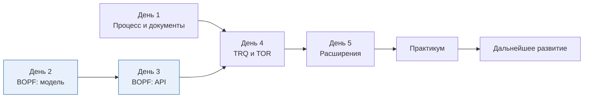

# SAP TM для ABAP-разработчика: курс быстрого погружения

Курс для опытного ABAP-разработчика, который впервые приходит в SAP Transportation Management (TM).
Знание BOPF не требуется: технология разбирается с нуля, отдельно от специфики модуля.


## Что вы будете уметь через неделю

- Объяснить сквозной процесс TM и назвать документ на каждом шаге.
- Читать модель любого бизнес-объекта BOPF и находить в ней нужный узел, действие или проверку.
- Читать и изменять документы TM через BOPF API, не ломая транзакционную модель.
- Находить данные фрахтового заказа, единицы фрахта или заказа на экспедирование в коде и в БД.
- Выбирать правильную точку расширения и находить стандартную логику в отладчике.

## Программа

| День | Тема | ⏱ | Результат дня |
|---|---|---|---|
| 1 | [Карта модуля: процесс, документы, мастер-данные](docs/day1-tm-landscape.md) | 60 мин | Знаете, какой документ TM за что отвечает |
| 2 | [BOPF, часть 1: модель бизнес-объекта](docs/day2-bopf-model.md) | 60 мин | Читаете модель BO в транзакции BOBF |
| 3 | [BOPF, часть 2: программирование](docs/day3-bopf-programming.md) | 60 мин | Пишете чтение и изменение через Service Manager |
| 4 | [TM изнутри: TRQ, TOR и их связи](docs/day4-tm-objects.md) | 60 мин | Находите любые данные документа TM |
| 5 | [Расширение и отладка](docs/day5-extensibility.md) | 60 мин | Выбираете точку расширения под задачу |
| 6* | [Практикум: сквозное задание](docs/day6-capstone.md) | 90 мин | Делаете отчёт, валидацию и детерминацию |

\* Практикум необязателен, но именно он закрепляет материал. Его можно провести в пятницу второй половиной дня или в понедельник следующей недели.

Справочные материалы:
[глоссарий](docs/glossary.md) ·
[шпаргалка](docs/cheatsheet.md) ·
[дальнейшее развитие](docs/roadmap.md) ·
[примеры кода](code/)



Синим отмечены дни про BOPF. Они не зависят от TM, поэтому их можно проходить параллельно с днём 1.

## Почему именно 5 × 60 минут

- **Один час — предел для плотного материала.** После 45–60 минут нового понятийного аппарата усвоение резко падает. Лучше пять коротких сессий с ночным «перевариванием», чем один длинный день.
- **BOPF получает два дня.** Это главный барьер для новичка: без него код TM не читается. Модель и программирование разведены, чтобы сначала сложилась картинка, а потом появился код.
- **TM даётся в два захода.** День 1 даёт бизнес-карту без техники. День 4 накладывает на неё технику, когда BOPF уже понятен.
- **Каждый день наполовину практика.** Около 25 минут теории и 25–30 минут работы в системе. Понятия, которые не «потроганы» руками, забываются за выходные.
- **Практикум отдельно.** Сквозное задание требует 90 минут без спешки. Втиснутое в час, оно превращается в копипаст.

Итого 5 часов ядра и 1,5 часа практикума. Меньше нельзя без потери BOPF. Больше на старте не нужно: глубокие темы вынесены в [дальнейшее развитие](docs/roadmap.md).

## Как устроен каждый день

| Блок | Назначение |
|---|---|
| 🎯 Цель | Что вы должны уметь в конце часа |
| ⏱ Тайминг | Разбивка часа по блокам |
| 🧠 Теория | Только необходимое, со схемами |
| 🛠 Практика | Задания в системе с бланком для заполнения |
| ✅ Самопроверка | 4–5 вопросов, ответы спрятаны под катом |
| 📌 Запомнить | 3–5 строк, которые стоит унести с собой |

## Что нужно подготовить заранее

- Доступ к песочнице S/4HANA с активированным TM. Подойдёт и отдельная система SAP TM 9.x, отличия касаются только интеграции.
- Полномочия на транзакции BOBF, /BOBF/TEST_UI, BOPF_EWB, SE11, SE16, SE24, SE18, SE80 и на отладку.
- Доступ к Fiori launchpad или NWBC с ролями TM, чтобы открывать документы в интерфейсе.
- Номера двух-трёх тестовых документов: фрахтовый заказ с назначенными единицами фрахта и исходный заказ. Попросите их у функционального консультанта, это экономит полчаса на первом дне.
- Пакет и транспортный запрос для практикума в пространстве имён Z.

## Структура репозитория

```
README.md          программа и порядок прохождения
docs/              занятия, глоссарий, шпаргалка, дорожная карта
assets/            иллюстрации SVG
code/              примеры ABAP к занятиям и практикуму
```

## Оговорка о версиях

Технические имена приведены для S/4HANA TM (пространство имён `/SCMTMS/`) и в основном совпадают с SAP TM 9.x.
Состав узлов, действий и запросов отличается между релизами.
Поэтому каждое имя в курсе стоит один раз проверить в транзакции BOBF вашей системы. Это и есть часть практики.
