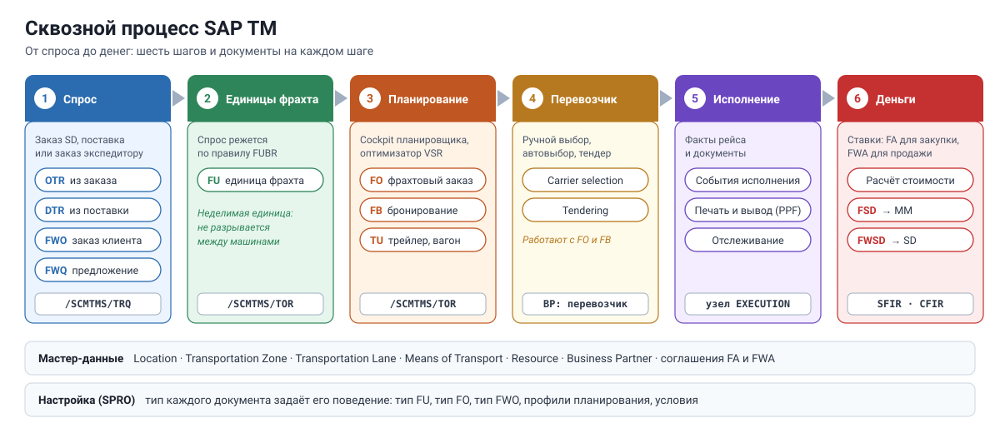
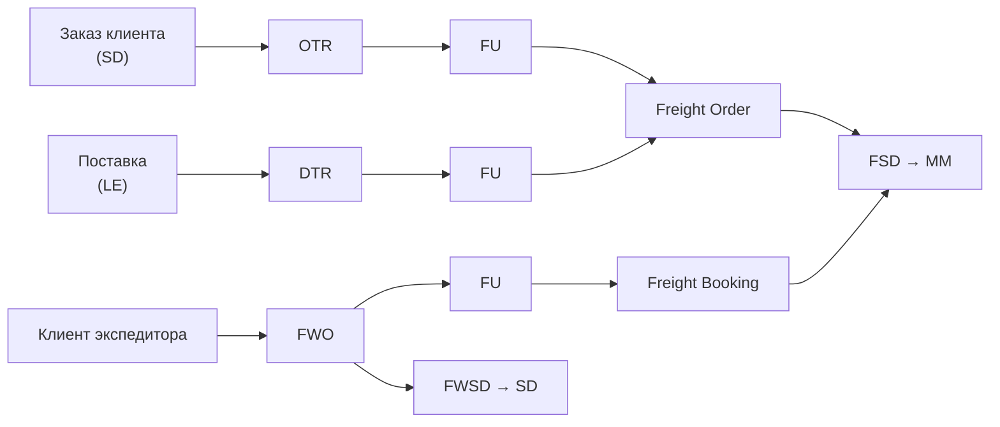
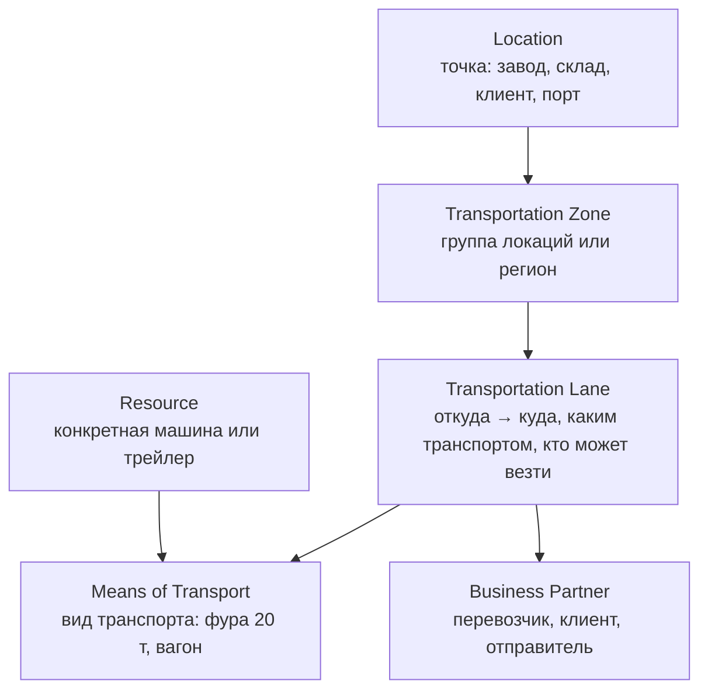

# День 1. Карта модуля: процесс, документы, мастер-данные

[← Программа](../README.md) · [День 2 →](day2-bopf-model.md)

## 🎯 Цель

К концу часа вы объясняете путь от заказа клиента до счёта перевозчика и называете документ TM на каждом шаге.
Техники сегодня почти нет: нужна бизнес-карта, на которую потом ляжет код.

## ⏱ Тайминг

| Мин | Блок |
|---|---|
| 0–10 | Что такое TM и где он живёт |
| 10–30 | Сквозной процесс и документы |
| 30–40 | Мастер-данные и настройка типов |
| 40–55 | Практика: разбор одного фрахтового заказа |
| 55–60 | Самопроверка |

---

## 🧠 1. Что такое TM и где он живёт

SAP TM отвечает на четыре вопроса:

1. **Что везти?** Потребность в перевозке.
2. **Как везти?** Планирование: маршрут, транспорт, загрузка.
3. **Кто везёт?** Выбор перевозчика.
4. **Сколько стоит?** Расчёт стоимости и взаиморасчёты.

Два бизнес-сценария определяют, откуда приходит потребность:

| Сценарий | Кто | Откуда потребность | Ключевой документ спроса |
|---|---|---|---|
| **Грузоотправитель** (shipper) | Производитель, ритейл | Свои заказы SD/MM и поставки | OTR, DTR |
| **Логистический провайдер** (LSP) | Экспедитор, 3PL | Заказы клиентов на перевозку | Forwarding Order |

Варианты развёртывания для разработчика почти не отличаются:

- **Встроенный TM** в S/4HANA. Заказы и поставки превращаются в документы TM внутри одной системы.
- **Отдельный TM** (side-by-side, или SAP TM 9.x). Те же объекты, но спрос приходит по интерфейсам из ERP.

Код и объекты одинаковы: всё лежит в пространстве имён `/SCMTMS/`.
Ещё в S/4HANA есть деление на **Basic Shipping** и **Advanced TM**. Это набор функций по лицензии, а не другая архитектура.

## 🧠 2. Сквозной процесс

Шесть шагов, которые стоит выучить наизусть:

1. **Спрос.** Заказ клиента или поставка из SD/LE превращается в OTR или DTR. У экспедитора спрос приходит как Forwarding Order.
2. **Формирование единиц фрахта.** Спрос режется на Freight Units (FU). FU — это неделимая единица планирования: её нельзя разорвать между двумя машинами. Как резать, задаёт правило Freight Unit Building Rule (FUBR).
3. **Планирование.** FU назначаются на Freight Order (свой или нанятый транспорт) или на Freight Booking (место на судне или самолёте). Планировщик работает в Transportation Cockpit, может подключить оптимизатор.
4. **Перевозчик.** Перевозчик назначается вручную, через автоматический выбор или через тендер.
5. **Исполнение.** Фиксируются события: погрузка, отправление, прибытие. Печатаются документы.
6. **Деньги.** Рассчитывается стоимость по соглашениям. Расчётные документы уходят в MM (оплата перевозчику) и в SD (счёт клиенту).

### Документы TM

| Документ | Сокращение | Что это | Шаг |
|---|---|---|---|
| Order-Based Transportation Requirement | OTR | Потребность из заказа клиента или заказа на поставку | 1 |
| Delivery-Based Transportation Requirement | DTR | Потребность из поставки | 1 |
| Forwarding Order | FWO | Заказ клиента на перевозку у экспедитора | 1 |
| Forwarding Quotation | FWQ | Предложение клиенту до заказа | 1 |
| Freight Unit | FU | Неделимая единица планирования | 2 |
| Freight Order | FO | Рейс: транспорт, маршрут, груз | 3 |
| Freight Booking | FB | Бронь у морского или авиаперевозчика | 3 |
| Transportation Unit | TU | Трейлер, вагон или контейнер как отдельная единица | 3 |
| Freight Agreement | FA | Договор с перевозчиком: ставки закупки | 6 |
| Forwarding Agreement | FWA | Договор с клиентом: ставки продажи | 6 |
| Freight Settlement Document | FSD | Расчёт с перевозчиком, уходит в MM | 6 |
| Forwarding Settlement Document | FWSD | Счёт клиенту, уходит в SD | 6 |

> Главная мысль дня. Есть **спрос** (что везти) и есть **исполнение** (как везти).
> Спрос живёт в OTR, DTR и FWO. Исполнение живёт в FU, FO, FB и TU.
> На дне 4 вы увидите, что это ровно два бизнес-объекта.

## 🧠 3. Мастер-данные и настройка типов

Мастер-данные отвечают на вопрос «где и чем можно возить».

- **Локации** в S/4HANA создаются из бизнес-партнёров, заводов и мест отгрузки. Хранятся в таблице `/SAPAPO/LOC`, это наследие SCM.
- **Перевозчик** — бизнес-партнёр с ролью перевозчика.
- **Организационные единицы TM** — закупочная организация (покупает перевозку), сбытовая (продаёт её), группа планирования и исполнения.

**Типы документов — главный рычаг настройки.**
У каждого документа есть тип из SPRO: тип FO, тип FU, тип FWO.
Тип задаёт нумерацию, правила, профили и поведение.
Для разработчика это главный критерий в условиях: «делать X только для FO типа ZFO1».

Путь в SPRO: `Transportation Management → Freight Order Management → Freight Order → Define Freight Order Types`.
Аналогично для FU (раздел Planning) и FWO (раздел Forwarding Order Management).

---

## 🛠 Практика (15 мин)

Возьмите тестовый фрахтовый заказ и откройте его в Fiori или NWBC. Заполните бланк.

| Вопрос | Ответ |
|---|---|
| Номер и тип FO | |
| Сколько FU назначено и из каких документов спроса они пришли | |
| Сколько стопов, откуда и куда | |
| Кто перевозчик | |
| Есть ли рассчитанная стоимость, какая сумма | |
| Какие документы видны в потоке документов (Document Flow) | |
| Какие события исполнения уже зафиксированы | |

Затем в SPRO найдите тип этого FO и посмотрите три любые настройки. Подумайте, как каждая влияет на поведение документа.

## ✅ Самопроверка

1. Чем Freight Unit отличается от Freight Order?

FU — неделимая единица груза для планирования, «что везём». FO — рейс, «чем и по какому маршруту везём». Один FO содержит много FU, а одна FU может ехать несколькими FO по этапам.

2. Откуда берутся OTR и DTR?

OTR создаётся из заказа клиента или заказа на поставку. DTR создаётся из поставки. Оба описывают спрос грузоотправителя.

3. Чем Freight Order отличается от Freight Booking?

FO описывает рейс, которым вы управляете целиком: машина, маршрут, стопы. FB описывает бронь мест у морского или авиаперевозчика, который сам управляет рейсом.

4. Какие документы TM передают данные в MM и SD?

Freight Settlement Document передаёт расходы перевозчика в MM. Forwarding Settlement Document передаёт выручку от клиента в SD.

5. Почему тип документа важен разработчику?

Тип определяет поведение документа. Почти любая доработка должна срабатывать только для определённых типов, иначе она заденет чужие процессы.

## 📌 Запомнить

- Спрос: OTR, DTR, FWO. Исполнение: FU, FO, FB, TU.
- FU — неделимая единица планирования. FO и FB — транспорт для неё.
- Деньги: соглашения, расчёт стоимости, FSD в MM, FWSD в SD.
- Тип документа из SPRO — главный критерий в доработках.
