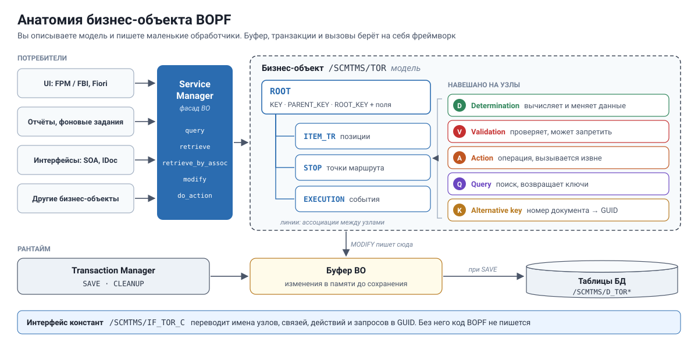
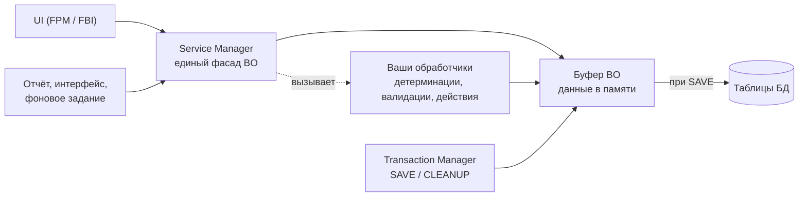

# День 2. BOPF, часть 1: модель бизнес-объекта

[← День 1](day1-tm-landscape.md) · [Программа](../README.md) · [День 3 →](day3-bopf-programming.md)

## 🎯 Цель

К концу часа вы открываете любой бизнес-объект в транзакции BOBF и находите в нём узлы, связи, проверки и действия.
Сегодня BOPF рассматривается как самостоятельная технология. TM служит только примером.

## ⏱ Тайминг

| Мин | Блок |
|---|---|
| 0–5 | Зачем нужен BOPF |
| 5–30 | Анатомия бизнес-объекта |
| 30–35 | Инструменты |
| 35–55 | Практика в BOBF и /BOBF/TEST_UI |
| 55–60 | Самопроверка |

---

## 🧠 1. Зачем нужен BOPF

Business Object Processing Framework (BOPF) — фреймворк SAP для бизнес-объектов.
Вы **описываете модель** объекта, а фреймворк **берёт на себя рутину**:

- буфер и транзакции: изменения копятся в памяти до сохранения;
- блокировки;
- вызов вашей логики в нужный момент;
- единый API для интерфейса, отчётов и интеграции;
- готовую привязку к UI на FPM.

Привычный ABAP-подход: класс, свои таблицы, свой `SAVE`, свой `ENQUEUE`, проверки в разных местах.
Подход BOPF: декларативная модель плюс маленькие классы-обработчики, которые фреймворк вызывает сам.

> Аналогия. BOPF — это «ORM плюс триггеры плюс единый фасад» поверх ваших таблиц.

## 🧠 2. Анатомия бизнес-объекта

### Узлы и ключи

- **Бизнес-объект (BO)** — например, `/SCMTMS/TOR`. Это модель, а не класс.
- **Узел (node)** — элемент дерева. Корень всегда называется `ROOT`, под ним дочерние узлы.
- **Экземпляр узла** — строка данных. У каждой строки есть три технических ключа:

| Поле | Тип | Смысл |
|---|---|---|
| `KEY` | GUID (RAW16) | Уникальный ключ этой строки |
| `PARENT_KEY` | GUID | Ключ родительской строки |
| `ROOT_KEY` | GUID | Ключ корня документа |

У каждого узла есть набор структур:

| Структура | Назначение |
|---|---|
| Persistent structure | Поля, которые хранятся в БД |
| Transient structure | Поля, которые вычисляются на лету и не хранятся |
| Combined structure (`…_K`) | Ключи плюс все поля. С ней вы работаете в коде |
| DB table | Таблица хранения узла |

### Что «навешано» на узлы

| Сущность | Что делает | Аналогия в ABAP |
|---|---|---|
| **Association** | Навигация между узлами: родитель → дети, ссылка на другой BO | Внешний ключ с готовым JOIN |
| **Determination** | Вычисляет и заполняет данные при изменении | Триггер или сеттер |
| **Validation** | Проверяет данные, может запретить действие или сохранение | `AUTHORITY-CHECK` и проверки перед `COMMIT` |
| **Action** | Операция над экземплярами, вызывается извне | Публичный метод |
| **Query** | Поиск экземпляров по критериям | `SELECT` с возвратом ключей |
| **Alternative key** | Бизнес-ключ, например номер документа | Уникальный вторичный индекс |

Подробнее о двух ключевых видах обработчиков.

**Детерминации** различаются моментом срабатывания:

| Момент | Когда | Типичное применение |
|---|---|---|
| After modify | Сразу после изменения узла | Пересчитать зависимые поля |
| Before save | Перед записью в БД | Присвоить номер, финальные вычисления |
| After loading | При чтении из БД | Заполнить transient-поля |

Детерминация срабатывает по **триггерам**: создание, изменение или удаление указанных узлов.

**Валидации** бывают двух видов:

- **Action validation** проверяет, можно ли выполнить действие. Если нет, действие не выполняется.
- **Consistency validation** проверяет данные после изменения и при сохранении. В зависимости от настройки она выдаёт сообщения или блокирует сохранение.

### Ещё три понятия

- **Делегированный узел** (delegated node). Узел, модель которого взята из другого объекта. Типичные примеры — тексты, вложения и расчёт стоимости в TM. Один раз смоделировано, используется во многих BO.
- **Интерфейс констант.** BOPF адресует всё по GUID, а не по именам. Для каждого BO генерируется интерфейс констант, который переводит имена в ключи: `/SCMTMS/IF_TOR_C=>SC_NODE-ROOT`, `=>SC_ASSOCIATION-ROOT-ITEM_TR`, `=>SC_ACTION-…`. Без него код BOPF не пишется.
- **Обработчик — это обычный класс.** У каждой детерминации, валидации и действия в модели указан класс ABAP. Найдя класс, вы нашли логику.

### Как это работает в рантайме

Главное правило: **никто не пишет в таблицы BO напрямую.** Все изменения идут через Service Manager, а сохранение — через Transaction Manager.

## 🧠 3. Инструменты

| Транзакция | Для чего |
|---|---|
| `BOBF` | Просмотр модели BO: узлы, структуры, обработчики, интерфейс констант |
| `/BOBF/TEST_UI` | Тестовый интерфейс: открыть экземпляр, пройти по связям, вызвать действие без кода |
| `BOPF_EWB` | Enhancement Workbench: расширение стандартных BO, разберём на дне 5 |
| `SE24` / `SE11` | Классы обработчиков, структуры и таблицы узлов |

---

## 🛠 Практика (20 мин)

### Часть 1. Модель в BOBF (12 мин)

Откройте транзакцию `BOBF` и бизнес-объект `/SCMTMS/TOR`. Заполните бланк.

| Что найти | Ответ |
|---|---|
| Имя интерфейса констант | |
| Пять дочерних узлов `ROOT` | |
| Таблица БД и combined structure узла `ROOT` | |
| Таблица БД узла `ITEM_TR` | |
| Альтернативный ключ на `ROOT` для номера документа | |
| Три детерминации на `ROOT` и их момент срабатывания | |
| Две валидации на `ROOT` | |
| Пять действий на `ROOT` | |
| Два запроса (query) на `ROOT` | |
| Класс-обработчик любой детерминации | |

Подсказка. Делегированные узлы в дереве отмечены отдельно. Найдите хотя бы один и посмотрите, на какой объект он ссылается.

### Часть 2. Тест-драйв в /BOBF/TEST_UI (8 мин)

1. Запустите `/BOBF/TEST_UI` и выберите `/SCMTMS/TOR`.
2. Найдите свой фрахтовый заказ из дня 1 через альтернативный ключ по номеру.
3. Пройдите по ассоциации от `ROOT` к позициям и к стопам.
4. Сравните увиденное с интерфейсом пользователя из дня 1.
5. Ничего не сохраняйте. Тестовый интерфейс работает с живыми данными.

## ✅ Самопроверка

1. Зачем в BOPF три ключа KEY, PARENT_KEY и ROOT_KEY?

`KEY` идентифицирует строку, `PARENT_KEY` связывает её с родителем, `ROOT_KEY` позволяет сразу найти весь документ. Так дерево любой глубины хранится в плоских таблицах.

2. Чем детерминация отличается от валидации?

Детерминация меняет данные. Валидация только проверяет и сообщает об ошибке, данные она не меняет.

3. Зачем нужен интерфейс констант?

BOPF адресует узлы, связи и действия по GUID. Интерфейс констант переводит понятные имена в эти GUID.

4. Где искать логику, которая заполняет какое-то поле?

В BOBF среди детерминаций узла. У каждой указан класс-обработчик, в нём и логика.

5. Можно ли сделать UPDATE в таблицу узла из своего кода?

Нет. Буфер BOPF и детерминации ничего об этом не узнают, данные станут несогласованными. Только Service Manager и Transaction Manager.

## 📌 Запомнить

- BO — дерево узлов. Строка узла имеет `KEY`, `PARENT_KEY`, `ROOT_KEY`.
- Детерминация меняет данные, валидация проверяет, действие — операция, запрос — поиск.
- Всё адресуется по GUID через интерфейс констант `…_C`.
- `BOBF` показывает модель, `/BOBF/TEST_UI` позволяет её «потрогать».
