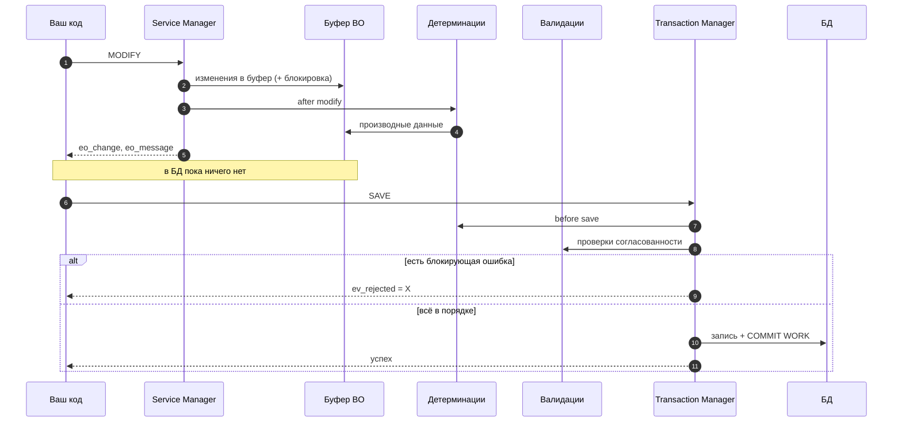

# День 3. BOPF, часть 2: программирование

[← День 2](day2-bopf-model.md) · [Программа](../README.md) · [День 4 →](day4-tm-objects.md)

## 🎯 Цель

К концу часа вы читаете и изменяете данные бизнес-объекта через BOPF API.
Вы понимаете, что происходит между `MODIFY` и `SAVE`, и чем код «снаружи» объекта отличается от кода «внутри».

## ⏱ Тайминг

| Мин | Блок |
|---|---|
| 0–10 | Два менеджера и четыре операции |
| 10–25 | Чтение, изменение, действие, сохранение |
| 25–30 | Снаружи и внутри: правила для обработчиков |
| 30–55 | Практика: отчёт по фрахтовому заказу |
| 55–60 | Самопроверка |

---

## 🧠 1. Два менеджера и четыре операции

| Объект | Как получить | Для чего |
|---|---|---|
| **Service Manager** | `/BOBF/CL_TRA_SERV_MGR_FACTORY=>GET_SERVICE_MANAGER( <ключ BO> )` | Всё про данные одного BO |
| **Transaction Manager** | `/BOBF/CL_TRA_TRANS_MGR_FACTORY=>GET_TRANSACTION_MANAGER( )` | Сохранение и откат, один на все BO |

Методы Service Manager, которые нужны в 90 % случаев:

| Метод | Что делает |
|---|---|
| `CONVERT_ALTERN_KEY` | Номер документа → GUID |
| `QUERY` | Поиск по критериям → GUID и данные |
| `RETRIEVE` | GUID → данные узла |
| `RETRIEVE_BY_ASSOCIATION` | GUID → данные связанного узла |
| `MODIFY` | Создать, изменить, удалить строки узлов |
| `DO_ACTION` | Вызвать действие |

Методы Transaction Manager: `SAVE` записывает буфер в БД с `COMMIT`, `CLEANUP` отбрасывает изменения.

Ключи везде передаются таблицей `/BOBF/T_FRW_KEY`, это таблица строк с одним полем `KEY`.
Почти каждый метод возвращает `EO_MESSAGE` (сообщения) и `ET_FAILED_KEY` (ключи, на которых операция не удалась). Проверяйте оба.

## 🧠 2. Четыре шаблона кода

### Чтение: номер → ключ → данные → связанные данные

```abap
DATA(lo_srv) = /bobf/cl_tra_serv_mgr_factory=>get_service_manager(
                 /scmtms/if_tor_c=>sc_bo_key ).

" Номер документа -> технический ключ
DATA lt_tor_id TYPE STANDARD TABLE OF /scmtms/tor_id WITH EMPTY KEY.
lt_tor_id = VALUE #( ( |{ p_torid ALPHA = IN }| ) ).

lo_srv->convert_altern_key(
  EXPORTING iv_node_key   = /scmtms/if_tor_c=>sc_node-root
            iv_altkey_key = /scmtms/if_tor_c=>sc_alternative_key-root-tor_id
            it_key        = lt_tor_id
  IMPORTING et_key        = DATA(lt_root_key) ).

" Заголовок
DATA lt_root TYPE /scmtms/t_tor_root_k.
lo_srv->retrieve( EXPORTING iv_node_key = /scmtms/if_tor_c=>sc_node-root
                            it_key      = lt_root_key
                  IMPORTING et_data     = lt_root ).

" Позиции по ассоциации ROOT -> ITEM_TR
DATA lt_item TYPE /scmtms/t_tor_item_tr_k.
lo_srv->retrieve_by_association(
  EXPORTING iv_node_key    = /scmtms/if_tor_c=>sc_node-root
            it_key         = lt_root_key
            iv_association = /scmtms/if_tor_c=>sc_association-root-item_tr
            iv_fill_data   = abap_true
  IMPORTING et_data        = lt_item
            et_key_link    = DATA(lt_link) ).   " какая позиция к какому заголовку
```

`ET_KEY_LINK` нужен, когда вы читаете сразу много документов. Он говорит, какая дочерняя строка к какому родителю относится.

### Изменение: таблица модификаций

```abap
" Новое значение поля заголовка. ZZ_COMMENT — пример поля из расширения
DATA(lr_root) = NEW /scmtms/s_tor_root_k( ).
lr_root->key        = ls_root-key.
lr_root->zz_comment = 'Проверено'.

DATA(lt_mod) = VALUE /bobf/t_frw_modification(
  ( node           = /scmtms/if_tor_c=>sc_node-root
    change_mode    = /bobf/if_frw_c=>sc_modify_update
    key            = ls_root-key
    data           = lr_root
    changed_fields = VALUE #( ( `ZZ_COMMENT` ) ) ) ).

lo_srv->modify( EXPORTING it_modification = lt_mod
                IMPORTING eo_message      = DATA(lo_msg)
                          eo_change       = DATA(lo_change) ).
```

- `CHANGE_MODE` принимает значения из `/BOBF/IF_FRW_C`: `SC_MODIFY_CREATE`, `SC_MODIFY_UPDATE`, `SC_MODIFY_DELETE`.
- `CHANGED_FIELDS` обязателен при обновлении. Без него BOPF не поймёт, какие поля менять, и не запустит нужные детерминации.
- Для создания дочерней строки дополнительно заполните `ASSOCIATION`, `SOURCE_NODE` и `SOURCE_KEY`. Новый GUID даёт `/BOBF/CL_FRW_FACTORY=>GET_NEW_KEY( )`.

### Действие

```abap
lo_srv->do_action( EXPORTING iv_act_key    = /scmtms/if_tor_c=>sc_action-root-<имя_действия>
                             it_key        = lt_root_key
                   IMPORTING eo_message    = lo_msg
                             et_failed_key = DATA(lt_failed) ).
```

Имя действия и структуру его параметров смотрите в BOBF. Параметры передаются ссылкой в `IS_PARAMETERS`.

### Сохранение

```abap
DATA(lo_tra) = /bobf/cl_tra_trans_mgr_factory=>get_transaction_manager( ).
lo_tra->save( IMPORTING ev_rejected = DATA(lv_rejected)
                        eo_message  = lo_msg ).
IF lv_rejected = abap_true.
  " сохранение отклонено валидациями: смотрим lo_msg
  lo_tra->cleanup( ).
ENDIF.
```

Сообщения из `EO_MESSAGE` достаются методом `GET_MESSAGES`. Каждое сообщение — объект исключения с текстом, узлом и ключом строки.

### Что происходит между MODIFY и SAVE



## 🧠 3. Снаружи и внутри

Код бывает двух видов, и правила у них разные.

| | Снаружи: потребитель | Внутри: обработчик |
|---|---|---|
| Где | Отчёт, интерфейс, BAdI вне BO | Детерминация, валидация, действие |
| Чтение | `lo_srv->retrieve…` | `io_read->retrieve…` |
| Изменение | `lo_srv->modify` | `io_modify->update / create / delete` |
| Сохранение | `lo_tra->save` | Никогда. Сохраняет вызывающий |
| Сообщения | Читаете `eo_message` | Создаёте `eo_message` и добавляете в него |

Каркас детерминации:

```abap
CLASS zcl_tm_d_example DEFINITION PUBLIC FINAL CREATE PUBLIC
  INHERITING FROM /bobf/cl_lib_d_supercl_simple.
  PUBLIC SECTION.
    METHODS /bobf/if_frw_determination~execute REDEFINITION.
ENDCLASS.

CLASS zcl_tm_d_example IMPLEMENTATION.
  METHOD /bobf/if_frw_determination~execute.
    " it_key    — строки, на которых сработал триггер
    " io_read   — чтение из буфера текущей транзакции
    " io_modify — изменения в буфере
    " is_ctx    — контекст: какой узел, какая детерминация
  ENDMETHOD.
ENDCLASS.
```

Для валидаций и действий есть аналогичные базовые классы `/BOBF/CL_LIB_V_SUPERCL_SIMPLE` и `/BOBF/CL_LIB_A_SUPERCL_SIMPLE`.

### ⛔ Что нельзя делать в обработчиках

- `COMMIT WORK` или `ROLLBACK WORK`. Транзакцией управляет фреймворк.
- Вызывать Service Manager своего же BO. Используйте `io_read` и `io_modify`.
- Читать таблицы BO через `SELECT`. В буфере могут быть несохранённые изменения, а в БД их нет.
- Обрабатывать строки по одной в цикле с отдельным чтением на каждую. Обработчики получают пачку ключей, читайте пачкой.
- Делать долгие операции: вызовы RFC, ожидания. Обработчик срабатывает при каждом изменении.

---

## 🛠 Практика (25 мин)

Возьмите отчёт [`zr_tm_fo_overview.abap`](../code/zr_tm_fo_overview.abap) и создайте его в своей системе.

1. **Запустите** отчёт для фрахтового заказа из дня 1. Сверьте позиции и стопы с интерфейсом.
2. **Найдите в отладчике**, что возвращает `ET_KEY_LINK` при чтении позиций.
3. **Добавьте** вывод событий исполнения через ассоциацию `ROOT → EXECUTION`. Имя ассоциации и тип таблицы найдите в BOBF.
4. **Включите чтение нескольких документов.** Сделайте параметр `SELECT-OPTIONS` и разложите позиции по документам с помощью `ET_KEY_LINK`.
5. **Со звёздочкой.** Найдите в BOBF запрос на `ROOT`, который ищет по атрибутам, и замените им `CONVERT_ALTERN_KEY`.

## ✅ Самопроверка

<details>
<summary>1. Вы вызвали MODIFY и не вызвали SAVE. Что будет в БД?</summary>

Ничего. Изменения живут только в буфере и пропадут в конце сессии. Блокировка документа при этом держится до конца сессии или до `CLEANUP`.
</details>

<details>
<summary>2. Зачем при обновлении передавать CHANGED_FIELDS?</summary>

BOPF меняет только перечисленные поля. По этому же списку он решает, какие детерминации и валидации запускать.
</details>

<details>
<summary>3. Почему в детерминации нельзя читать данные через SELECT?</summary>

В буфере могут быть изменения, которые ещё не сохранены. `SELECT` вернёт старые данные из БД.
</details>

<details>
<summary>4. Что означает ev_rejected = X после SAVE?</summary>

Валидация или блокировка не позволили сохранить. Причина в `eo_message`. Буфер нужно исправить или очистить через `CLEANUP`.
</details>

<details>
<summary>5. Чем io_modify в детерминации отличается от lo_srv->modify в отчёте?</summary>

`io_modify` работает внутри текущего цикла обработки, без повторного входа во фреймворк. Service Manager — внешний вход, из обработчика своего BO его вызывать нельзя.
</details>

## 📌 Запомнить

- Service Manager — данные. Transaction Manager — сохранение.
- Шаблон чтения: `CONVERT_ALTERN_KEY` → `RETRIEVE` → `RETRIEVE_BY_ASSOCIATION`.
- `MODIFY` пишет в буфер, только `SAVE` пишет в БД.
- Внутри обработчиков только `io_read` и `io_modify`, никаких `COMMIT` и `SELECT`.
