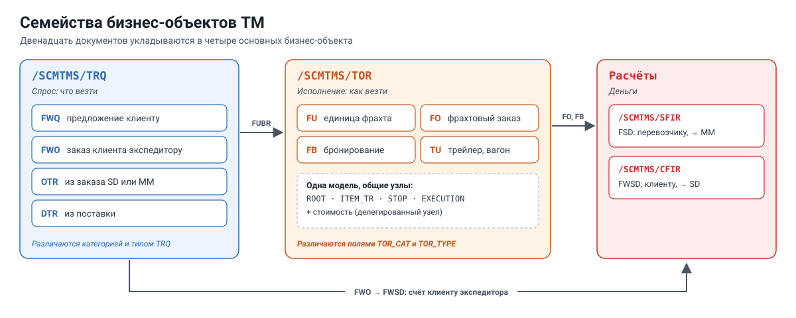
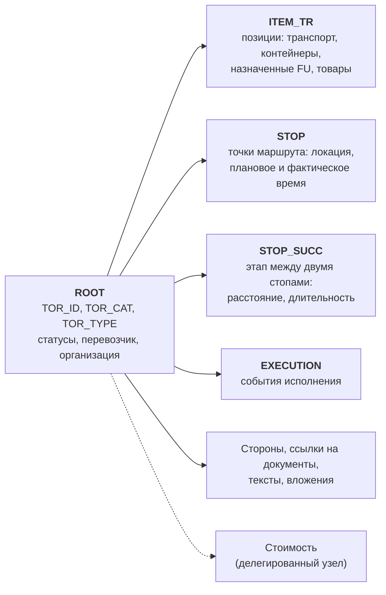
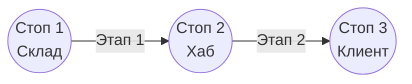
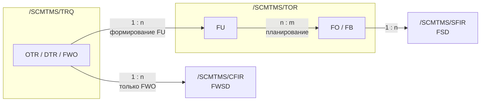

# День 4. TM изнутри: TRQ, TOR и их связи

[← День 3](day3-bopf-programming.md) · [Программа](../README.md) · [День 5 →](day5-extensibility.md)

## 🎯 Цель

К концу часа вы знаете, в каком бизнес-объекте и узле лежит любой документ TM.
Вы умеете пройти от спроса к единицам фрахта и к фрахтовому заказу в коде и в БД.

## ⏱ Тайминг

| Мин | Блок |
|---|---|
| 0–10 | Карта бизнес-объектов TM |
| 10–25 | TOR: один объект для FU, FO, FB и TU |
| 25–30 | TRQ, связи между документами, статусы |
| 30–55 | Практика: один документ в трёх представлениях |
| 55–60 | Самопроверка |

---

## 🧠 1. Карта бизнес-объектов

Двенадцать документов из дня 1 укладываются в несколько бизнес-объектов.



| Бизнес-объект | Что внутри | Чем различаются документы |
|---|---|---|
| `/SCMTMS/TRQ` — Transportation Request | OTR, DTR, FWO, FWQ | Категория TRQ и тип TRQ |
| `/SCMTMS/TOR` — Transportation Order | FU, FO, FB, TU | Поле `TOR_CAT` и тип `TOR_TYPE` |
| `/SCMTMS/SFIR` — Supplier Freight Invoice Request | Freight Settlement Document | — |
| `/SCMTMS/CFIR` — Customer Freight Invoice Request | Forwarding Settlement Document | — |

Расчёт стоимости — это не отдельный документ. Он смоделирован один раз и подключён к TOR и TRQ как **делегированный узел**.
Соглашения, мастер-данные и настройки тоже имеют свои объекты. Найдите их сами в BOBF по маске `/SCMTMS/*`.

> Главная мысль дня. FU, FO, FB и TU — это **один** бизнес-объект `/SCMTMS/TOR`.
> У них общие узлы: позиции, стопы, исполнение, стоимость.
> Поэтому любая доработка на TOR по умолчанию срабатывает для всех четырёх. Фильтруйте по `TOR_CAT` и `TOR_TYPE` первой строкой.

## 🧠 2. TOR изнутри

### Дерево узлов



Расположение узлов в дереве и их точные имена проверьте в BOBF своей версии.

### Стопы и этапы

Маршрут — это цепочка стопов, а между соседними стопами лежит этап.



- Стоп хранит локацию, плановое и фактическое время, признак погрузки или выгрузки.
- Груз «садится» на одном стопе и «сходит» на другом. Так одна FU едет только часть маршрута FO.

### Позиции образуют иерархию

Узел `ITEM_TR` плоский, но строки ссылаются друг на друга и образуют дерево:

```
Транспортное средство (позиция-ресурс)
 └─ Назначенная FU
     └─ Товар или упаковка
```

Когда FU назначают на FO, её позиции появляются в FO. Связь между FU и FO хранится через эти позиции и стопы.
Читать её проще через готовые ассоциации и вспомогательные классы, чем собирать вручную. Найдите их в BOBF и в SE24 по маске `/SCMTMS/CL_TOR*HELPER*`.

### Хранение в БД

| Узел | Таблица |
|---|---|
| `ROOT` | `/SCMTMS/D_TORROT` |
| `ITEM_TR` | `/SCMTMS/D_TORITE` |
| `STOP` | `/SCMTMS/D_TORSTP` |
| `EXECUTION` | `/SCMTMS/D_TOREXE` |

В таблицах ключ строки называется `DB_KEY`, связь с родителем — `PARENT_KEY`.
Для TRQ имена аналогичные, например `/SCMTMS/D_TRQROT`.

**`SELECT` из этих таблиц допустим** в отчётах на чтение, когда важна скорость на больших объёмах.
**Запись — только через BOPF.** В обработчиках — только `io_read`.

## 🧠 3. TRQ, связи и статусы

### TRQ коротко

Структура проще, чем у TOR: заголовок, позиции, стопы, стороны, стоимость.
Тип документа определяет категория: OTR, DTR, FWO или FWQ. Значения категорий смотрите в интерфейсе констант `/SCMTMS/IF_TRQ_C`.

### Как документы связаны



- Связь FU с FO — «многие ко многим». Одна FU может ехать двумя FO по этапам, один FO везёт много FU.
- Поток документов (Document Flow) в интерфейсе строится по ссылкам из узла ссылок на документы и по назначениям.

### Статусы

Статусы хранятся полями на `ROOT`: жизненный цикл, планирование, исполнение, расчёты и другие.

**Не меняйте статус прямым обновлением поля.** Почти для каждого перехода есть действие: оно проверит допустимость и сделает сопутствующие изменения.

### Интерфейсы констант

| Интерфейс | Содержимое |
|---|---|
| `/SCMTMS/IF_TOR_C` | Сгенерированные ключи модели TOR: узлы, связи, действия, запросы |
| `/SCMTMS/IF_TRQ_C` | То же для TRQ |
| `/SCMTMS/IF_TOR_CONST` и подобные | Прикладные значения: категории, статусы, типы позиций |

Правило: ключи модели берите из `…_C`, бизнес-значения — из `…_CONST`. Не пишите в коде литералы `'TO'` или `'FU'`.

---

## 🛠 Практика (25 мин)

Цель — увидеть один фрахтовый заказ в трёх представлениях: интерфейс, BOPF и БД.

| Шаг | Где | Что сделать | Ответ |
|---|---|---|---|
| 1 | SE16 | В `/SCMTMS/D_TORROT` найдите FO по `TOR_ID`. Запишите `DB_KEY`, `TOR_CAT`, `TOR_TYPE` | |
| 2 | SE16 | В `/SCMTMS/D_TORSTP` найдите стопы этого FO по `PARENT_KEY` | |
| 3 | SE16 | В `/SCMTMS/D_TORITE` найдите позиции. Как устроена иерархия? | |
| 4 | /BOBF/TEST_UI | Откройте FO и найдите назначенные FU. Через какую связь они видны? | |
| 5 | /BOBF/TEST_UI | Откройте одну FU. Найдите, из какого документа спроса она создана | |
| 6 | SE24 | Откройте `/SCMTMS/IF_TOR_CONST`. Найдите константы категорий TOR | |
| 7 | Код | Доработайте отчёт из дня 3: выводите `TOR_CAT` и фильтруйте документы по категории через константу | |

## ✅ Самопроверка

<details>
<summary>1. Вы написали детерминацию на ROOT объекта TOR для фрахтовых заказов. Что ещё она заденет?</summary>

Единицы фрахта, бронирования и транспортные единицы. Все они живут в том же объекте. Нужна фильтрация по `TOR_CAT` и `TOR_TYPE` в начале обработчика.
</details>

<details>
<summary>2. В каком объекте лежит Forwarding Order, а в каком Freight Booking?</summary>

FWO — в `/SCMTMS/TRQ`. Freight Booking — в `/SCMTMS/TOR`.
</details>

<details>
<summary>3. Почему связь FU с FO — «многие ко многим»?</summary>

FU может перевозиться несколькими FO по разным этапам маршрута. Один FO обычно везёт много FU.
</details>

<details>
<summary>4. Как правильно сменить статус документа?</summary>

Вызвать соответствующее действие. Прямое изменение поля пропускает проверки и сопутствующую логику.
</details>

<details>
<summary>5. Когда допустим SELECT из /SCMTMS/D_TORROT?</summary>

В отчётах только на чтение, вне обработчиков BOPF, когда нужна скорость на больших объёмах и не важны несохранённые изменения.
</details>

## 📌 Запомнить

- Спрос — `/SCMTMS/TRQ`. Исполнение — `/SCMTMS/TOR`. Расчёты — `SFIR` и `CFIR`.
- FU, FO, FB, TU — один объект. Сначала фильтр по `TOR_CAT` и `TOR_TYPE`.
- Маршрут — стопы и этапы. Груз — иерархия позиций.
- Статусы меняются действиями, а не обновлением поля.
