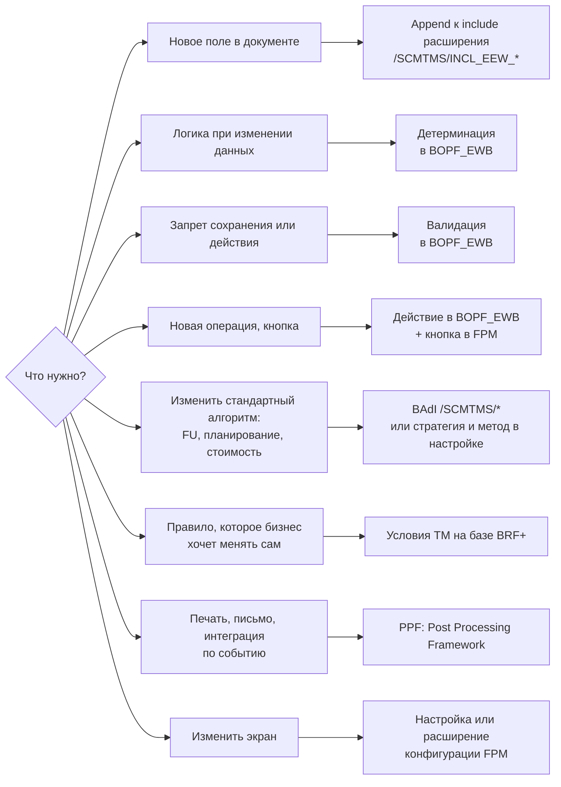
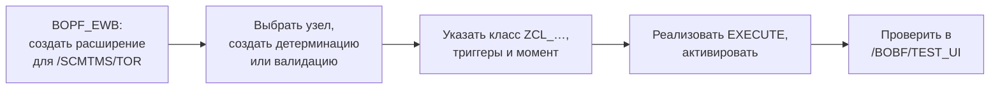

# День 5. Расширение и отладка

[← День 4](day4-tm-objects.md) · [Программа](../README.md) · [Практикум →](day6-capstone.md)

## 🎯 Цель

К концу часа вы выбираете правильную точку расширения под типовую задачу.
Вы знаете шаги расширения бизнес-объекта и умеете найти стандартную логику в отладчике.

## ⏱ Тайминг

| Мин | Блок |
|---|---|
| 0–10 | Карта инструментов расширения |
| 10–25 | Расширение BO: поля и обработчики |
| 25–30 | Отладка: как найти, кто меняет поле |
| 30–55 | Практика |
| 55–60 | Самопроверка |

---

## 🧠 1. Карта инструментов расширения

Начинайте не с инструмента, а с вопроса «что нужно сделать».

| Инструмент | Где | Когда |
|---|---|---|
| Include расширения | SE11 | Новое поле, которое хранится и видно в BO |
| Расширение BO | `BOPF_EWB` | Своя детерминация, валидация, действие, даже свой узел |
| BAdI | `SE18` / `SE19`, спот `/SCMTMS/*` | Стандарт предусмотрел точку для вмешательства в алгоритм |
| Стратегии и методы | SPRO | Шаги обработки, например планирования, собираются из методов. Можно добавить свой метод |
| Условия | SPRO, BRF+ | Выбор значения по правилам: тип FU, профиль, перевозчик |
| PPF | `SPPFCADM` | Действие после сохранения: печать, отправка, вызов интерфейса |
| FPM | Конфигурации компонентов | Поля, кнопки, разметка экрана |

Порядок предпочтения: **настройка → условие → BAdI → расширение BO**. Модификация стандарта — никогда.

## 🧠 2. Расширение бизнес-объекта

### Новое поле

1. Найдите include расширения нужного узла. Для TOR это, например, `/SCMTMS/INCL_EEW_TOR_ROOT` и `/SCMTMS/INCL_EEW_TOR_ITEM`.
2. Добавьте append-структуру с полями `ZZ_…`.
3. Активируйте. Поле появится в persistent-, combined-структуре и в таблице узла.
4. Чтобы поле появилось на экране, добавьте его в конфигурацию FPM. Каталог полей интерфейса строится по модели BO, поэтому поле уже доступно для выбора.

Если поле должно вычисляться, а не храниться, его добавляют в transient-структуру и заполняют детерминацией «after loading».

### Свой обработчик

Создание проходит по мастеру в `BOPF_EWB`:

1. Создайте объект расширения для стандартного BO. Один на проект, имя в Z-пространстве.
2. На нужном узле добавьте детерминацию, валидацию или действие.
3. Укажите класс-обработчик. Мастер может сгенерировать каркас.
4. Для детерминации задайте триггеры: какие узлы и какие изменения её запускают. Задайте момент срабатывания.
5. Для валидации, которая должна блокировать сохранение, выберите соответствующую настройку. Варианты различаются между релизами, проверьте их в мастере.
6. Реализуйте `EXECUTE` и проверьте в `/BOBF/TEST_UI`.

### Правила хорошего расширения

- **Фильтр первой строкой.** `TOR_CAT` и `TOR_TYPE`, иначе логика сработает для всех FU, FO, FB и TU.
- **Узкие триггеры.** Детерминация на «любое изменение ROOT» срабатывает десятки раз за одно действие пользователя.
- **Пачка, а не цикл.** Читайте все `IT_KEY` одним вызовом `io_read`.
- **Сообщения с привязкой.** Передавайте узел и ключ строки, тогда интерфейс подсветит нужный документ.
- **Включаемость.** Держите выключатель в Z-таблице настроек, чтобы отключить доработку без транспорта.

## 🧠 3. Отладка: как найти, кто меняет поле

Логика TM разбросана по сотням обработчиков. Ищите не перебором, а от модели.

1. **По модели.** В `BOBF` найдите детерминации узла, у которых в триггерах есть нужный узел. Поставьте точки останова в их классах.
2. **Без интерфейса.** Воспроизведите изменение в `/BOBF/TEST_UI`. Меньше постороннего кода в стеке.
3. **Точка наблюдения.** Если не помогло, остановитесь в своём шаге и поставьте watchpoint на поле структуры данных узла.
4. **Стек вызовов.** Найдя место, поднимитесь по стеку до вызова обработчика фреймворком. Так вы узнаете, какая детерминация или действие работает.
5. **Журналы.** Ошибки фоновых процессов, интеграции и планирования ищите в `SLG1`.
6. **Производительность.** `SAT` для времени выполнения, `ST05` для SQL. Типичная проблема — обработчик, который читает по одной строке.

---

## 🛠 Практика (25 мин)

### Часть 1. Найти стандартную логику (12 мин)

1. В `BOBF` на узле `ROOT` объекта `/SCMTMS/TOR` выберите детерминацию, которая срабатывает при изменении стопов.
2. Поставьте точку останова в её классе.
3. Измените время стопа фрахтового заказа в интерфейсе или в `/BOBF/TEST_UI`.
4. В отладчике посмотрите `IS_CTX`, `IT_KEY` и стек вызовов. Найдите в стеке Service Manager.

### Часть 2. Карта точек расширения (13 мин)

1. В `SE18` найдите спотов расширений по маске `/SCMTMS/*`. Выпишите три BAdI, полезных для вашего проекта.
2. В `BOPF_EWB` посмотрите, есть ли в системе существующие расширения для `/SCMTMS/TOR`. Если есть, разберите одно.
3. В SE11 откройте `/SCMTMS/INCL_EEW_TOR_ROOT`. Есть ли уже append-структуры от других проектов?

## ✅ Самопроверка

1. Бизнес хочет сам менять правило выбора типа FU по региону. Какой инструмент?

Условие TM на базе BRF+. Правило меняется в настройке без разработки.

2. Нужно отправлять фрахтовый заказ во внешнюю систему после сохранения. Что выбрать?

PPF. Он срабатывает после сохранения, умеет повторять отправку и показывает журнал. Детерминация для этого не подходит: она выполняется до записи в БД и может сработать много раз.

3. Почему детерминация с триггером на любое изменение ROOT — плохая идея?

Она будет срабатывать на каждое изменение заголовка, в том числе на изменения от других детерминаций. Это лишняя нагрузка и риск зацикливания.

4. Какие шаги нужны, чтобы новое поле появилось на экране FO?

Append к include расширения узла, активация, затем добавление поля в конфигурацию FPM.

## 📌 Запомнить

- Сначала настройка и условия, потом BAdI, потом расширение BO. Модификация — никогда.
- Поле — append к `/SCMTMS/INCL_EEW_*`. Логика — `BOPF_EWB`. После сохранения — PPF.
- Логику ищите от модели: BOBF → обработчик → точка останова.
- Первая строка любого обработчика на TOR — фильтр по категории и типу.
