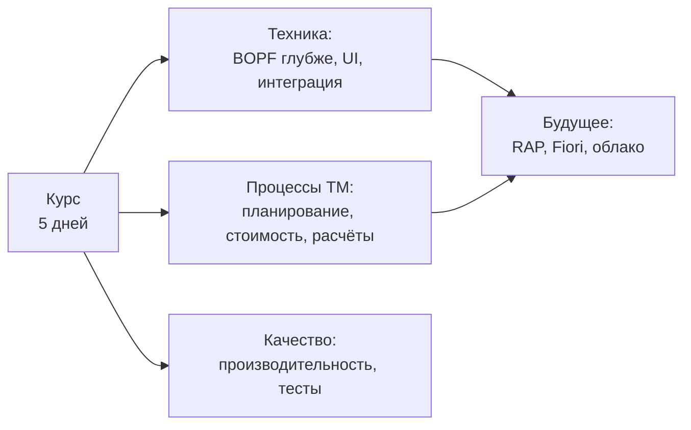

# Дальнейшее развитие

[← Практикум](day6-capstone.md) · [Программа](../README.md)

Курс сознательно оставил за скобками много тем. Ниже они сгруппированы по направлениям.
Каждую тему стоит брать, когда она понадобилась в проекте: так она усваивается в разы быстрее.

Время указано для первого знакомства с темой, а не для экспертного уровня.

## Техника

| Тема | Зачем | С чего начать | ⏱ |
|---|---|---|---|
| **BOPF глубже** | Блокировки, авторизация, Status and Action Management, делегированные объекты, свои узлы | `BOBF`: настройки узлов и действий; документация BOPF в SAP Help | 4–6 ч |
| **Модульные тесты BOPF** | Тестировать обработчики без БД и интерфейса | Тестовые двойники `io_read` и `io_modify`, ABAP Unit | 3–4 ч |
| **Хелперы TM** | Готовые методы для типовых задач вместо своего кода | SE24 по маске `/SCMTMS/CL_*HELPER*` | 2–3 ч |
| **Создание документов из кода** | Создать FU, FO или FWO программно корректно | Фабрики и действия создания в BOBF, отладка интерфейса создания | 4–6 ч |
| **FPM и FBI** | Свои экраны, сложные изменения конфигураций, feeder-классы | Транзакции FPM, конфигурации компонентов TM | 6–8 ч |
| **Fiori-приложения TM** | Новые интерфейсы S/4HANA и их расширение | Fiori Apps Reference Library, приложения TM | 4–6 ч |
| **Интеграция с ERP** | Как заказы и поставки становятся OTR и DTR, обратная передача | Интеграция LE-TRA, BAdI интеграции, сервисы SOA | 6–8 ч |
| **Внешние интерфейсы** | Обмен с перевозчиками и системами отслеживания | Прокси SOA (`SPROXY`, `SRT_MONI`), IDoc (`WE02`), PPF | 4–6 ч |
| **CDS и аналитика** | Отчёты без чтения BO построчно, встроенная аналитика | CDS-представления TM в S/4HANA, поиск по маске имён TM | 3–4 ч |

## Процессы TM

| Тема | Зачем | С чего начать | ⏱ |
|---|---|---|---|
| **Формирование FU** | Правила FUBR, типичные доработки при разбиении | SPRO: Planning → Freight Unit, BAdI формирования FU | 3–4 ч |
| **Планирование** | Профили выбора и планирования, Transportation Cockpit, оптимизатор VSR | Настройка профилей, стратегии и методы планирования | 8–10 ч |
| **Стратегии и методы** | Встраивание своих шагов в стандартные алгоритмы | SPRO: определение стратегий и методов, классы методов | 3–4 ч |
| **Расчёт стоимости** | Расчётные листы, тарифы, шкалы, частые доработки ставок | Делегированный узел стоимости, BAdI расчёта стоимости | 8–10 ч |
| **Расчёты и интеграция с MM и SD** | Путь FSD и FWSD в финансовые документы, начисления | SFIR и CFIR в BOBF, интеграция с заказом на услуги и фактурой | 6–8 ч |
| **Выбор перевозчика и тендеринг** | Автоматическое назначение, обмен предложениями | Профили выбора перевозчика, тендерные процессы | 4–6 ч |
| **Исполнение и отслеживание** | События, интеграция с системами отслеживания | Узел `EXECUTION`, SAP Business Network for Logistics | 4–6 ч |
| **Условия на BRF+** | Правила, которые бизнес настраивает сам | SPRO: определение условий TM, транзакция `BRF+` | 3–4 ч |
| **Смежные модули** | EWM, опасные грузы, таможня, управление двором | Документация интеграции конкретного модуля | по задаче |

## Качество

| Тема | Зачем | С чего начать | ⏱ |
|---|---|---|---|
| **Производительность** | Массовая обработка, планирование тысяч FU | `SAT`, `ST05`, анализ триггеров детерминаций | 4–6 ч |
| **Фоновая обработка** | Массовые операции, параллелизация, повтор при ошибке | Фоновые отчёты TM, PPF, `SLG1` | 3–4 ч |
| **Обновление релиза** | Что ломается в расширениях при апгрейде | Release notes, проверка расширений BOPF и BAdI | по задаче |

## Будущее

| Тема | Зачем | С чего начать | ⏱ |
|---|---|---|---|
| **RAP** | SAP развивает новые объекты на ABAP RESTful Application Programming Model. Ядро TM пока на BOPF, но новые приложения и интерфейсы могут использовать RAP | Документация RAP, сравнение понятий BOPF и RAP | 8–12 ч |
| **Различия релизов S/4HANA** | Состав функций и объектов меняется от релиза к релизу | What's New для TM в вашем релизе | 2 ч |
| **Облачные сценарии** | Расширения в стиле clean core, released API | Списки released API и точки расширения для облака | 4–6 ч |

## Как выбирать следующую тему

1. **Есть задача в проекте** — берите тему под неё.
2. **Задачи нет, проект только стартует** — начните с создания документов из кода, хелперов TM и интеграции с ERP. Они нужны почти в каждом проекте.
3. **Вы ведущий разработчик** — добавьте производительность, модульные тесты и RAP.
